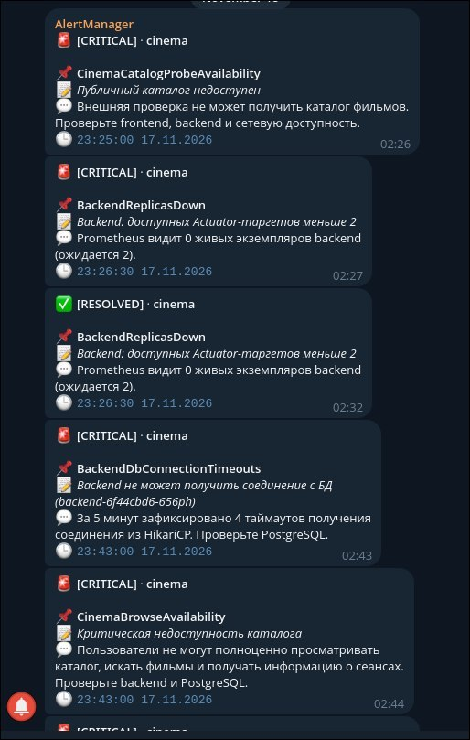
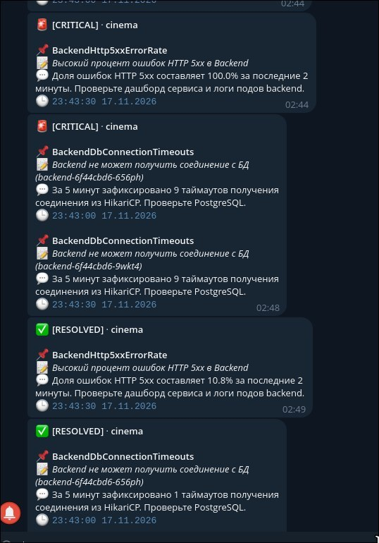
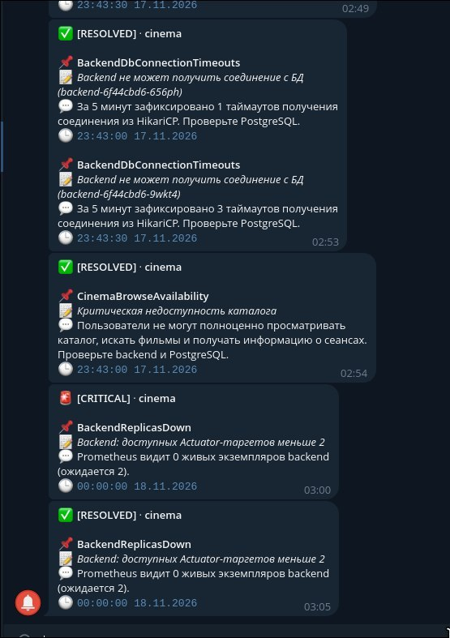

# Развёртывание Cinema в Minikube

Команды выполняются из корня репозитория. Нужны Docker, Minikube, kubectl, Kustomize (или версия kubectl со встроенным Kustomize), Helm и Bash.

## Приложение

```bash
minikube start
eval "$(minikube -p minikube docker-env)"
docker build -t cinema-backend:latest .
docker build -t cinema-frontend:latest ./frontend
cp k8s/overlays/minikube/secrets.env.example k8s/overlays/minikube/secrets.env
```

Перед применением замените значения `DB_PASSWORD` и `JWT_SECRET` в `k8s/overlays/minikube/secrets.env`. Файл исключён из Git. Если JWT-секрет из старого `.env.example` когда-либо использовался, замените его.

```bash
kubectl apply -k k8s/overlays/minikube
kubectl -n cinema rollout status deployment/backend
kubectl -n cinema rollout status deployment/frontend
kubectl -n cinema get pods,services
kubectl -n cinema delete configmap cinema-config --ignore-not-found
kubectl -n cinema delete secret cinema-secrets --ignore-not-found
```

Общие параметры находятся в `k8s/base/config/app.env`, параметры базы данных — в `k8s/base/config/postgres.env`. После изменения ConfigMap Kustomize меняет его имя с хешем и обновляет ссылки в Pod шаблонах. Применяйте каталог overlay повторно:

```bash
kubectl apply -k k8s/overlays/minikube
```

Для удаления устаревших ConfigMap после нескольких применений используйте метку `app.kubernetes.io/part-of=cinema`:

```bash
kubectl apply -k k8s/overlays/minikube --prune -l app.kubernetes.io/part-of=cinema --prune-allowlist=core/v1/ConfigMap
```

## Мониторинг и логирование

```bash
helm repo add vm https://victoriametrics.github.io/helm-charts/
helm repo add prometheus-community https://prometheus-community.github.io/helm-charts
helm repo add grafana-community https://grafana-community.github.io/helm-charts
helm repo update
helm upgrade --install vm-single vm/victoria-metrics-single --version 0.49.0 --namespace monitoring --create-namespace --values observability/monitoring/victoria-metrics.yaml
helm upgrade --install blackbox-exporter prometheus-community/prometheus-blackbox-exporter --namespace monitoring --values observability/blackbox-exporter.yaml
bash observability/grafana/deploy.sh
kubectl apply -k k8s/observability/logging
```

Правила SLO формируются Sloth и сохраняются в каталог с Kustomization:

```bash
bash observability/slo/deploy-rules.sh
```

Скрипт проверяет и генерирует правила в `k8s/observability/slo/rules.yaml`, затем применяет monitoring и logging Kustomization. Изменение правил создаёт ConfigMap с новым хешем и обновляет vmalert.

Откройте Grafana и VictoriaMetrics в отдельных терминалах:

```bash
kubectl -n monitoring port-forward svc/grafana 3000:80
kubectl -n monitoring port-forward svc/vm-single-victoria-metrics-single-server 8428:8428
```

Панель называется `Cinema SLI SLO SLA`. Логи и правила vmalert находятся в namespace `logging`; метрики, дашборд и SLO — в `monitoring`.

## Алерты и уведомления

Алертинг развёртывается Kustomize вместе с остальной observability-конфигурацией. Для отправки уведомлений используется Telegram: Alertmanager принимает события от двух экземпляров `vmalert` — один вычисляет метрики и SLO в namespace `monitoring`, второй выполняет LogsQL-правила по логам в `logging`.

Перед первым применением создайте локальный файл с учётными данными бота. Не коммитьте его: путь уже добавлен в `.gitignore`.

```bash
cp k8s/observability/alerting/telegram.env.example k8s/observability/alerting/telegram.env
# Отредактируйте telegram.env: укажите токен Telegram-бота и chat ID.
kubectl apply -k k8s/observability/alerting
kubectl -n monitoring rollout status deployment/alertmanager
kubectl -n monitoring rollout status deployment/vmalert-metrics
kubectl -n logging rollout status deployment/vmalert
kubectl -n monitoring get configmaps,deployments,services
```

Файл `telegram.env` содержит две строки `TG_BOT_TOKEN=...` и `CHAT_ID=...`. Kustomize создаёт из него Secret `telegram-secrets`, монтируемый Alertmanager только для чтения. Настройки маршрутизации и шаблон сообщений находятся в `k8s/observability/alerting/config/alertmanager.yml`. Критические уведомления отправляются после 10 секунд группировки и повторяются раз в час; предупреждения группируются 30 секунд и повторяются раз в 4 часа. При критическом алерте предупреждения того же сервиса подавляются. Отправляются и события `firing`, и `resolved`.

Правила хранятся в `k8s/observability/alerting/config/`:

- `runtime-alerts.yaml`: таймауты HikariCP, заполнение old-gen JVM выше 85% в течение 10 минут, менее двух доступных Actuator-целей в течение 2 минут и доля HTTP 5xx выше 5% в течение 1 минуты. Первые три помогают обнаружить проблемы БД, риск нехватки памяти и потерю реплик; 5xx показывает влияние ошибок на запросы.
- `slo-alerts.yaml`: сгенерированные Sloth multi-window burn-rate алерты для доступности пользовательских сценариев. Критическое срабатывание означает быстрое расходование error budget, предупреждение — устойчивое ухудшение.
- `alerts.yaml`: LogsQL-алерт на более чем 500 неуспешных входов за 5 минут, который помогает заметить всплеск ошибок аутентификации.

Для просмотра входящих событий откройте Telegram-чат, указанный в `CHAT_ID`. Для проверки состояния правил и Alertmanager можно временно открыть их интерфейсы:

```bash
kubectl -n monitoring port-forward svc/alertmanager 9093:9093
kubectl -n monitoring port-forward svc/vmalert-metrics 8880:8880
kubectl -n logging port-forward svc/vmalert 8881:8880
```

После этого доступны страницы [Alertmanager](http://localhost:9093), [vmalert metrics](http://localhost:8880) и vmalert логов на `http://localhost:8881`. Изменения правил или маршрутизации применяются повторно той же командой `kubectl apply -k k8s/observability/alerting`.

### Скриншоты срабатываний

В `imgs/5.jpg`–`imgs/7.jpg` приведены реальные Telegram-уведомления о срабатывании и восстановлении алертов: доступность каталога, число backend-реплик, HTTP 5xx и таймауты подключений к PostgreSQL.







## Демонстрация SLI/SLO/SLA

```bash
kubectl -n cinema scale deployment/backend --replicas=3
kubectl -n cinema get pods -w
kubectl -n cinema scale deployment/postgres --replicas=0
kubectl -n cinema scale deployment/postgres --replicas=1
```

Отправляйте запросы к каталогу через frontend и наблюдайте показатели. Blackbox-запросы помечаются заголовком `X-Synthetic-Probe` и учитываются отдельно от пользовательских SLI. Проверка синтетического probe SLO строится по `probe_success` за выбранное окно, а не по текущему моментальному значению.

Для интерфейса VictoriaMetrics:

```bash
bash k8s/observability/vmui.sh
```
