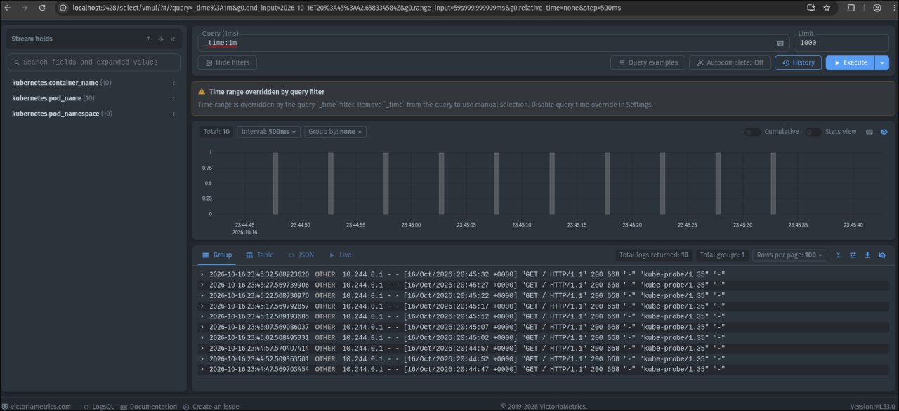
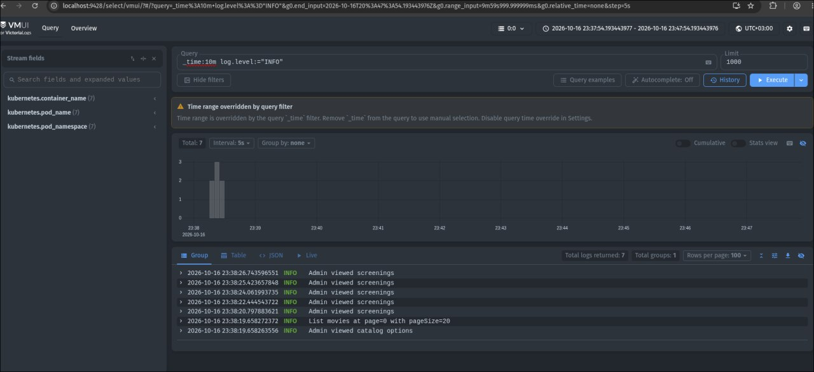
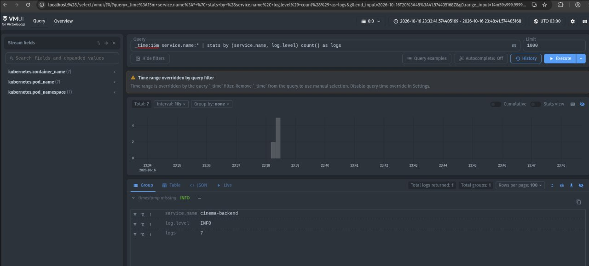

# Отчёт

## Приложение

Сервис продажи билетов в кино: каталог фильмов, расписание сеансов, выбор мест и покупка билетов.

Стек: React, Java 25 и Spring Boot, REST API, PostgreSQL, Valkey, Docker и Minikube.

## Kubernetes

- `Namespace` `cinema` изолирует ресурсы приложения.
- `Deployment` запускают frontend и backend по две реплики, PostgreSQL и Valkey — по одной.
- `Service` обеспечивают внутреннее взаимодействие компонентов; frontend опубликован через `NodePort` на порту `30080`.
- `PersistentVolumeClaim` хранит данные PostgreSQL при перезапуске Pod.
- `ConfigMap` содержит настройки, `Secret` — пароль БД и JWT-ключ.
- Readiness- и liveness-пробы проверяют состояние backend, PostgreSQL и Valkey.

## Взаимодействие

Браузер обращается к frontend через `NodePort`. Nginx во frontend проксирует `/api` на backend `Service`. Backend обрабатывает REST-запросы, хранит данные в PostgreSQL и использует Valkey для ограничения частоты запросов. Сервисы обнаруживаются внутри кластера по DNS-именам Kubernetes `backend`, `postgres` и `valkey`.

## VictoriaLogs

1. Сырые записи за последнюю минуту


2. Получение записей с уровнем ```INFO``` за посление 10 минут


3. Логи за последние 15 минут, содержащие поле ```service.name``` и группирующиеся по паре ```service.name``` и ```log.level```


4. 10 наиболее часто встречающихся значений поля ```event``` backend-сервиса ```cinema-backend``` за последние 15 минут

