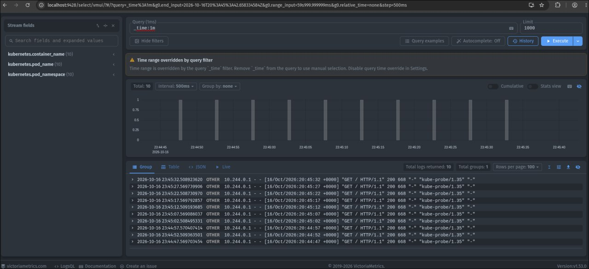
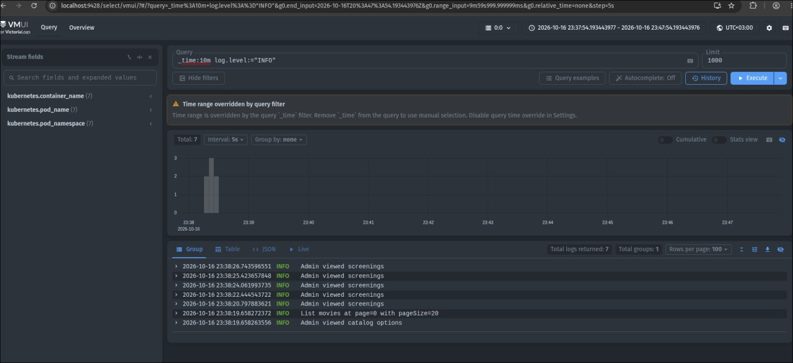
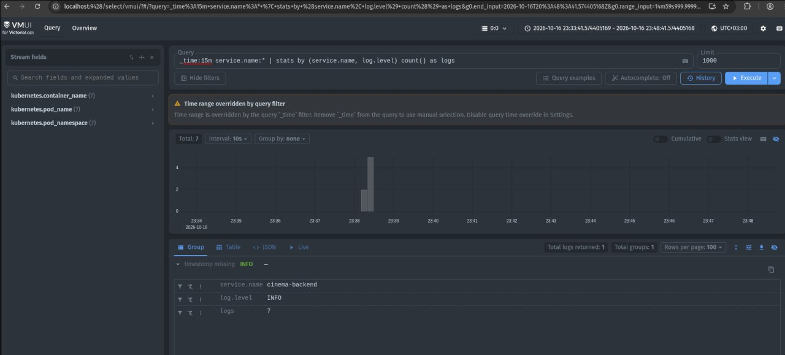
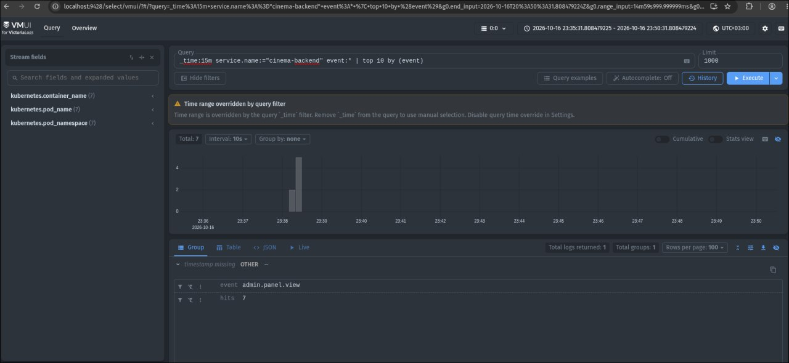

# Отчёт: сбор логов в VictoriaLogs

## Приложение и развёртывание

Приложение — сервис продажи билетов в кино (`cinema-backend` и frontend). Оно запущено в Minikube в namespace `cinema`. VictoriaLogs single-node развернута в том же кластере в namespace `logging` как `StatefulSet` с PVC на 5 ГиБ; HTTP Service доступен внутри кластера на порту `9428`. Для хранения задан срок ретенции 7 дней.

Манифесты VictoriaLogs, сборщика и правила vmalert находятся в [`k8s/observability/`](k8s/observability/): `victoria-logs.yaml`, `victoria-logs-collector.yaml`, `vmalert.yaml`. Чтобы применить конфигурацию из корня репозитория:

```sh
kubectl apply -f k8s/observability/
kubectl -n logging get pods,services,pvc
kubectl port-forward -n logging svc/victoria-logs 9428:9428
```

После запуска port-forward интерфейс vmui доступен по адресу [http://localhost:9428/vmui/](http://localhost:9428/vmui/).

## Формат и доставка логов

Backend пишет структурированные JSON-логи в stdout в формате ECS. Настройка находится в `src/main/resources/application.yml`: поля включают время (`@timestamp`), уровень (`log.level`), сообщение (`message`) и имя сервиса (`service.name=cinema-backend`); прикладные события, например `event`, позволяют фильтровать и агрегировать записи по действиям.

Доставку выполняет `vlagent` в виде DaemonSet: агент на узле читает контейнерные логи из `/var/log`, автоматически обнаруживает метаданные Kubernetes и отправляет записи по native HTTP endpoint `/insert/native` VictoriaLogs. Такой сбор централизован для подов и не требует менять код приложения или добавлять сайдкар к каждой реплике. Логи namespace `logging` и `kube-system` исключены из сбора.

## Запросы LogsQL в vmui

Запросы выполнены в vmui; скриншоты показывают результаты. В запросах используются имена полей из ECS-логов.

### 1. Сырые записи за последнюю минуту

```logsql
_time:1m
```

Показывает последние поступившие записи за минуту — полезно для быстрой проверки, что логи приходят.



### 2. Фильтр по уровню за 10 минут

```logsql
_time:10m log.level:="INFO"
```

Оставляет записи уровня `INFO` за последние 10 минут, позволяя быстро просмотреть штатные события.



### 3. Подсчёт по сервису и уровню

```logsql
_time:15m service.name:* | stats by (service.name, log.level) count() as logs
```

Группирует записи за 15 минут по имени сервиса и уровню, а `logs` показывает количество записей в каждой группе.



### 4. Частые события backend

```logsql
_time:15m service.name:="cinema-backend" event:* | top 10 by (event)
```

Показывает до десяти наиболее частых значений поля `event` у backend за последние 15 минут; помогает увидеть, какие действия формируют основной поток логов.



## Бонус: vmalert

В `vmalert.yaml` задано правило `TooManyFailedLogins`: оно считает события `auth.login.failure` за 5 минут и срабатывает при числе больше пяти. Проверка выполняется vmalert, но настроен `blackhole` notifier, поэтому внешние уведомления не отправляются.

---

# Практика: экспорт метрик в VictoriaMetrics

## Стек и сбор метрик

Приложение продажи билетов развёрнуто в Minikube. VictoriaMetrics Single установлена Helm-релизом `vm-single` из чарта `victoria-metrics-single` версии `0.49.0` в namespace `monitoring`.

Метрики Spring Boot и JVM экспортируются через Micrometer Prometheus Registry и Actuator по адресу `/actuator/prometheus` на management-порту `8081`. В манифесте backend заданы аннотации `prometheus.io/scrape`, `prometheus.io/port` и `prometheus.io/path`. VictoriaMetrics использует Kubernetes service discovery, чтобы находить такие pod’ы.

Для PostgreSQL в pod базы добавлен `postgres-exporter`; он публикует метрики по адресу `/metrics` на порту `9187` и также обнаруживается по Prometheus-аннотациям.

## Бизнес-метрики

Клиент Micrometer в `BusinessMetrics` регистрирует счётчики успешной и неуспешной регистрации и авторизации, попыток и результатов бронирования, проданных билетов и поисков фильмов. Таймер `cinema.booking.duration` измеряет длительность бронирования. Метрики обновляются в контроллерах и сервисах приложения.

## Проверка

В развёрнутом кластере backend и frontend отвечали по HTTP со статусом `200`. Все три реплики backend были готовы. Запрос VictoriaMetrics `up` показывал доступные цели сбора, в том числе backend и PostgreSQL exporter; после поискового запроса в VictoriaMetrics наблюдался `cinema_movie_searches_total`. Метрики PostgreSQL также поступали в VictoriaMetrics.

Проверить данные можно через API VictoriaMetrics:

```sh
kubectl -n monitoring port-forward svc/vm-single-victoria-metrics-single-server 8428:8428
curl "http://localhost:8428/api/v1/query?query=up"
curl "http://localhost:8428/api/v1/query?query=cinema_movie_searches_total"
curl "http://localhost:8428/api/v1/label/__name__/values"
```

---

# Практика: SLI, SLO и SLA

## Метрики

Для оценки пользовательских сценариев используется `cinema_sli_requests_total`. Фильтр приложения группирует HTTP-запросы по фиксированным операциям: `catalog`, `movie_search`, `movie_details`, `cinema_list`, `screenings`, `seat_map`, `registration`, `authentication`, `booking`, `ticket_history` и `admin_catalog`. Метка `result` имеет значения `good` и `bad`. Ответ 5xx и ограничение частоты 429 считаются плохим результатом; ответы 4xx считаются корректно обработанными запросами.

Таймер `cinema_booking_duration_seconds` измеряет длительность успешной покупки билета. Замер заканчивается после возврата из транзакционного сервиса, то есть включает commit транзакции. Таймер записывает только успешные операции. Для него заданы histogram buckets 100 мс, 300 мс, 500 мс и 1 секунда. `cinema_booking_attempts_total` считает попытки, дошедшие до сервиса покупки.

Blackbox Exporter проверяет `GET /api/movies` через frontend. Служебный заголовок запроса исключает проверки пробера из пользовательских счётчиков. Результат проверки хранится отдельно в `probe_success`.

## Формулы SLI

Для операции `op` за окно `W`:

`SLI(op, W) = 1 - increase(cinema_sli_requests_total{operation="op",result="bad"}[W]) / increase(cinema_sli_requests_total{operation="op"}[W])`.

Для скорости бронирования:

`SLI_booking_latency(W) = increase(cinema_booking_duration_seconds_bucket{le="1.0"}[W]) / increase(cinema_booking_attempts_total[W])`.

Внешний SLI пробера:

`SLI_probe(W) = average(probe_success over W)`.

Значение SLI в процентах получается умножением результата формулы на 100%. Для демонстрации Grafana показывает SLI на коротком окне; цели SLO считаются на скользящем 30-дневном окне.

## SLO

На скользящем интервале 30 дней:

- Доступность каталога, поиска, карточки фильма, списка кинотеатров, расписания и карты мест — не менее 99% хороших запросов для каждого сценария.
- Доступность регистрации и авторизации — не менее 99% хороших запросов для каждой операции.
- Доступность бронирования — не менее 99% хороших запросов.
- Доступность просмотра истории билетов и административного каталога — не менее 99% хороших запросов для каждого сценария.
- Скорость бронирования — не менее 95% попыток заканчиваются успешным commit не позднее чем через 1 секунду.
- Внешняя проверка каталога — не менее 99,5% успешных проверок.

## SLA

Учебный SLA приложения: за скользящие 30 дней не менее 98,5% запросов перечисленных пользовательских сценариев завершаются хорошим ответом. Общий SLI приложения считается как сумма хороших запросов, делённая на сумму всех запросов. Это взвешенная доступность, где вес операции определяется её количеством запросов. Указанный порог предназначен для задания и не является реальным коммерческим обязательством.

## Изменения приложения и демонстрация

Фильтр запросов добавляет счётчики операций через `BusinessMetrics`. Низкокардинальные метки описывают сценарий и результат. При недоступности PostgreSQL запросы каталога, расписания и бронирования дают плохой результат и понижают соответствующие SLI, если продолжать посылать запросы во время сбоя. При отсутствии запросов счётчики не меняются.

В `observability/slo/cinema-slos.yaml` определены Sloth SLO. Скрипт `observability/slo/deploy-rules.sh` генерирует recording rules Sloth и разворачивает vmalert, который вычисляет их в VictoriaMetrics. Grafana подключена к VictoriaMetrics и показывает короткооконные SLI, 30-дневные SLO и SLA, latency бронирования и результат пробера. Шаги установки, обновления и демонстрации приведены в `k8s/README.md`.
